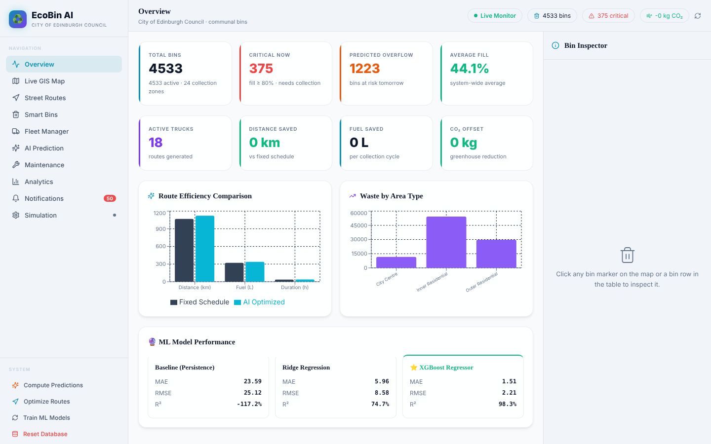
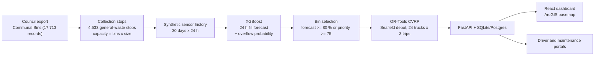

# EcoBin Edinburgh

**Smart waste collection for the City of Edinburgh's communal bins: 24-hour fill forecasting (XGBoost), capacitated vehicle routing (Google OR-Tools), a FastAPI backend and a React dashboard on an ArcGIS basemap.**

This repository adapts [EcoBin](https://github.com/RishvinReddy/EcoBin-Smart-Waste-Management-System) by Rishvin Reddy (MIT licence, upstream commit `a782a9c`), which was built for 100 synthetic bins in Hyderabad, to the **4,533 real general-waste communal-bin stops** published by City of Edinburgh Council. The stop locations, bin sizes and bin counts are real; the fill-level sensor readings are simulated, because the open data has none.



## Results

These come from **real stop locations with simulated fill levels**. They show how the methods behave on Edinburgh's network, not what the council would save.

**One day's plan** (last day of the synthetic history): 1,219 of the 4,533 stops are flagged for collection and routed as 51 trips by 18 trucks from Seafield, 920 km in total, with every flagged stop served.

**Collection strategies**, 7 test days x 2 seeds, daily means (`experiments/results/aggregate_results.csv`):

| Strategy | Stops collected | Distance (km) | CO₂ (kg) | Overflow events | Overflow bin-hours | Collections under 40 % full |
|---|--:|--:|--:|--:|--:|--:|
| Fixed rota (every third day) | 1,511 | 1,068 | 858 | 667 | 11,379 | 191 |
| Reactive (current fill ≥ 80 %) | 1,123 | 925 | 744 | 1,287 | 14,157 | 0 |
| Predictive (forecast ≥ 80 %) | 1,619 | 1,130 | 909 | 364 | 2,901 | 2 |
| Full EcoBin (forecast + priority score) | 1,619 | 1,123 | 903 | 363 | 2,915 | 2 |

Compared with the fixed rota, forecast-driven collection drives about 5 % further but cuts overflow bin-hours by about three quarters and almost never empties a bin that is under 40 % full. Reacting to current fill alone saves distance, but bins are about 92 % full on average by the time they are collected and many overflow first. The priority score adds little over the forecast here, because on simulated data the forecast is accurate enough that the overflow probability is nearly always 0 or 1. Ablation and weight-sensitivity results are in `experiments/results/ablation_results.csv` and `sensitivity_results.csv`.

**Forecasting** 24 hours ahead, test period (`ml/models/model_metadata.json`):

| Model | MAE | RMSE | R² | F1 at 80 % |
|---|--:|--:|--:|--:|
| Persistence (tomorrow = today) | 23.6 | 25.1 | -1.17 | 0.00 |
| Ridge regression | 6.0 | 8.6 | 0.75 | 0.52 |
| XGBoost | 1.5 | 2.2 | 0.98 | 0.85 |

Residual and calibration plots are in `experiments/figures/`.


---

## How it works



1. **Stops** (`ml/data_generator/edinburgh_stops.py`). Keeps `WS: Communal Bin` records, converts British National Grid coordinates to WGS84, drops records outside the council area, and merges asset records at the same spot into one collection stop. Capacity is `number_bins x bin_size`. Each stop gets an area type (distance from Princes Street) and one of 24 collection zones (k-means).
2. **History** (`ml/data_generator/generator.py`). EcoBin's hourly fill model (area rate x peak hour x weekend/holiday x temperature x rain x noise, emptied at 85 % or after 72 to 120 h) with Edinburgh weather, Scottish bank holidays, and a per-stop rate spread. Vectorised over all stops: 3.3 million hourly readings build in a couple of minutes.
3. **Forecasting** (`ml/forecasting/`). Lag, rolling and calendar features; XGBoost against Persistence and Ridge baselines on a time-based split (first 75 % of days train). Overflow probability is `1 - Phi((80 - forecast) / RMSE)`.
4. **Routing** (`optimization/`). Single-depot CVRP from Seafield, haversine distance x 1.3 road factor, PATH_CHEAPEST_ARC + guided local search, as in EcoBin. Trucks can make several trips per shift; stops the fleet cannot reach are reported as unserved rather than failing the solve.
5. **Experiments** (`optimization/experiment_runner.py`, `sensitivity_analysis.py`). Replays test days and compares collection strategies on distance, overflow and unnecessary collections, plus an ablation of EcoBin's priority weights.
6. **App** (`backend/`, `frontend/`). FastAPI with 40+ endpoints (IoT ingestion, predictions, routing, drivers, maintenance, QR identity, WebSocket); React dashboard with live GIS map, street-snapped routes (OSRM), fleet, prediction, analytics and simulation panels.

## What changed from EcoBin

| | EcoBin (upstream) | This repository |
|---|---|---|
| Bins | 100 hand-placed synthetic bins in Hyderabad | 4,533 stops from City of Edinburgh Council open data |
| Capacity | 180 to 500 L per bin | Real bin sizes x counts (median 2,560 L per stop) |
| Area types | 11 land-use types | City Centre / Inner / Outer Residential by distance from Princes Street |
| History | 365 days, Python loop per bin | 30 days (about 45x more readings per day), vectorised |
| Fleet | 5 trucks x 5,000 L, one trip | 24 trucks x 60,000 L, up to 3 trips each |
| Depot | Hyderabad city centre | Seafield Depot (next to Seafield recycling centre) |
| Solver | Python distance callback | Same algorithm; numpy distance matrix, multi-trip, unserved-bin fallback |
| Experiments | Per-bin Python loops (about 100 bins) | Vectorised engine shared by both studies |
| Basemap | CARTO light | Esri ArcGIS Light Gray (as on the council's ArcGIS Hub), with Streets, Topographic, Imagery and OSM |
| Live simulator | One HTTP request per bin per tick | One batched database update per tick |
| Holidays, weather | Hyderabad, monsoon | Scottish bank holidays 2026, Edinburgh climate |
| Email alerts | Upstream author's EmailJS keys hard-coded | Removed; alerts send only with your own keys in `.env` |

## Quick start

Requirements: Python 3.10+, Node.js 18+.

```bash
pip install -r requirements.txt
python run_pipeline.py              # stops, history, model, predictions, routes, smoke experiments (10-20 min)
python -m uvicorn backend.main:app --port 8000

cd frontend
npm install
npm run dev                         # http://localhost:5173
```

- Dashboard: `http://localhost:5173` · Driver portal: `/driver` (log in as `EDI-RCV-01` to `EDI-RCV-24`) · Maintenance portal: `/maintenance` (`MNT001` to `MNT004`) · API docs: `http://localhost:8000/docs`
- Longer experiments: `python -m optimization.experiment_runner development` (7 days x 2 seeds, about 15 min)
- Rebuild everything: `python run_pipeline.py --force-data`

With Docker (Postgres): `docker compose up --build`. The first start builds the data and model; run experiments with `docker compose exec backend python run_pipeline.py --skip-data --experiments smoke`.

All Edinburgh settings (depot, fleet, area parameters, history length, solver time) are in [`config/city.py`](config/city.py); the frontend mirror is [`frontend/src/config/city.ts`](frontend/src/config/city.ts).

## Repository layout

```
config/city.py                     Edinburgh constants (depot, fleet, area types, holidays)
data/raw/communal_bins.csv         Council export (Open Government Licence v3.0)
data/edinburgh_stops.csv           Derived collection stops
ml/data_generator/                 Stop builder and synthetic sensor history
ml/preprocessing/                  Feature engineering, calendar features
ml/forecasting/                    XGBoost / Ridge / Persistence, predictions, residual analysis
optimization/vrp_solver/solver.py  OR-Tools CVRP
optimization/daily_routes.py       Today's plan (shared by pipeline and API)
optimization/simulation.py         Experiment engine
experiments/                       Results (CSV) and figures
backend/main.py                    FastAPI app
frontend/                          React + Vite dashboard
hardware/wokwi/                    ESP32 sensor sketch for the Wokwi simulator
```

## Assumptions and limitations

- **Fill levels are simulated.** The council publishes where bins are, not how full they are. Model accuracy (R² 0.98) is measured on simulated data and is optimistic; real sensor data would be noisier.
- **Area types and zones are constructed.** The open data has no land-use field or collection-round field, so area types come from distance to the city centre and zones from k-means.
- **Fleet figures are assumptions.** 60,000 L of bin volume per load stands for a ~20 m³ body with ~3:1 compaction; 24 trucks and 3 trips per shift are illustrative, not council figures. Service time is EcoBin's 10 minutes per stop.
- **Distances are straight-line x 1.3**, as in EcoBin. The dashboard snaps routes to streets with the public OSRM demo server when it can (about one request per second, per its usage policy); otherwise it draws dashed straight lines.
- **One waste stream.** Only general-waste communal bins are routed. Packaging, glass, food and side-loading bins use different vehicles and would each be a separate problem.
- **No shift-length or time-window constraints**, as in EcoBin.

## Data and licences

- Bin data: City of Edinburgh Council, *Communal Bins*, via the council's ArcGIS Hub open spatial data site. Open Government Licence v3.0. *Copyright City of Edinburgh Council, contains Ordnance Survey data © Crown copyright and database right 2026.*
- Basemaps: Esri ArcGIS Online tile services (attribution shown on the map; subject to Esri's terms of use) and OpenStreetMap (© OpenStreetMap contributors).
- Code: MIT, see [LICENSE](LICENSE). Original EcoBin © 2025 Rishvin Reddy; Edinburgh adaptation © 2026 Chenyi.
- Libraries: FastAPI (MIT), Google OR-Tools (Apache 2.0), XGBoost (Apache 2.0), scikit-learn (BSD-3), React and Vite (MIT), Leaflet (BSD-2).
